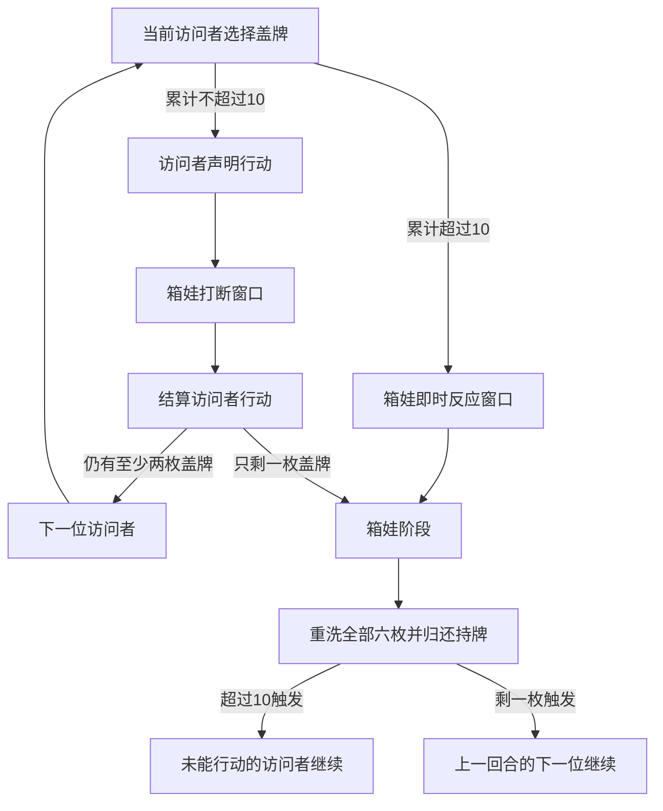

# 无声模式与基础回合引擎

更新：2026-10-26。

本阶段实现可组合的回合规则模块，依据[规则笔记](规则与首版范围.md)和[地图资料](地图资料.md)。网页目前仍开放四人入席和地图准备；正式开局需先补齐角落标志及卡牌设置，回合模块尚未接到 HTTP 动作和网页操作中。

## 模块与边界

| 模块 | 已实现 |
| --- | --- |
| [silent.mjs](../src/silent.mjs) | 六枚0—5标志、翻牌、跳过持牌、累计阈值、箱娃阶段触发、归还洗混及续轮。 |
| [movement.mjs](../src/movement.mjs) | 实际门和楼梯的单步目标、封门筛选、怨房初始潜伏角落、原房或相邻房的潜伏目标。 |
| [round.mjs](../src/round.mjs) | 地图完成后的基础回合组合、移动声明与打断窗口、位置结算、普通潜伏及分玩家视图。 |

本阶段未实现窥探结算、道具和能力效果、哭喊抽牌、能力设置、死亡转箱人或胜负。封门筛选接受能力结算提供的 `blockedDoors`；能力的使用门槛和生效期限待对应能力处理器实现。没有填入假定的标志数量、密码或弱点。

2026-10-26已补充[访问者道具](访问者道具.md)、[箱娃之力](箱娃之力.md)与[标志资料](标志资料.md)。超过10后的 `hako_reaction` 是现有组合接口预留的阶段窗口，不代表某张具体能力已获准在此发动；NO.5实际卡面注明箱娃行动阶段使用，NO.12则在无声模式排除。后续能力接入必须依照新核对的卡面时机。

## 初始化与动作

`createRound(setup, {hakoId, hidingCornerId, numbers})` 接收服务器保管的已完成地图状态。箱娃必须明确选择怨房中的一个初始角落。访问者从1楼大厅开始行动；调用者须先完成正门等待、角落标志和其他开局设置。

`numbers` 是测试时指定六枚牌序的可选参数，正式游戏默认洗混；该参数不应开放给浏览器指定。

通过 `applyRoundAction(round, playerId, action)` 执行：

| 动作类型 | 执行者与用途 |
| --- | --- |
| `silent_reveal`，`index` | 当前访问者选择一枚盖牌。 |
| `silent_skip`，`index` | 当前访问者选择一枚盖牌暂持并跳过；0已亮出时拒绝。 |
| `move`，`roomId` | 翻牌成功的访问者声明移动；此时位置尚未改变。 |
| `resolve_visitor_action` | 箱娃结束打断窗口，结算已声明移动；随后结束访问者行动。后续能力处理器在这里之前结算打断。 |
| `pass_noise_reaction` | 箱娃结束累计超过10后的即时反应窗口，进入箱娃阶段。 |
| `hako_hide`，`cornerId` | 箱娃阶段最后的普通移动与潜伏，允许留在原房换角落；随后重置无声标志。调用者须先结算可选哭喊、设置能力和阶段能力。 |

以上动作接口服务于底层组合，尚未作为网络接口开放；没有添加跳过未完成开局设置的网页入口。

## 阶段与续轮

- 恰好10仍可行动；超过10不结算该访问者行动。
- 跳过是一个结束的回合，同样检查是否只剩一枚盖牌。
- 跳过时持有的标志保持盖放，不向持有者或其他玩家暴露数字；箱娃阶段结束才归还。
- 超过10与只剩一枚同时满足时，以超过10处理，保留即时反应窗口并由未能行动的人续轮。
- 移动按房间计算。同一块板上的两间房须通过内部门，普通移动不能穿过两间房；箱娃普通移动也只允许原房或一步相邻房。

## 信息边界

`getRoundView(round, playerId)` 只允许本局四名玩家调用，并生成与内部状态不共享对象的视图。

- 六枚无声标志只有亮出的数字进入公共视图；暂持标志只公开持有者。
- 访问者位置和声明的移动目标是公共信息。
- 箱娃角落、所在房间及潜伏候选仅出现在箱娃自己的视图中。
- 公共视图不包含私有牌序、待续轮内部字段或整份回合对象；接入 SSE 时必须逐玩家调用此方法。

## 验证

运行 `npm test` 会统一覆盖地图、无声规则、移动、组合回合及 HTTP/SSE 服务。浏览器验收仍覆盖已开放的四人地图准备流程。

本阶段遵循用户的验证节奏：先完成整块实现，再集中添加测试、统一运行验证和修复，验证通过后提交。
