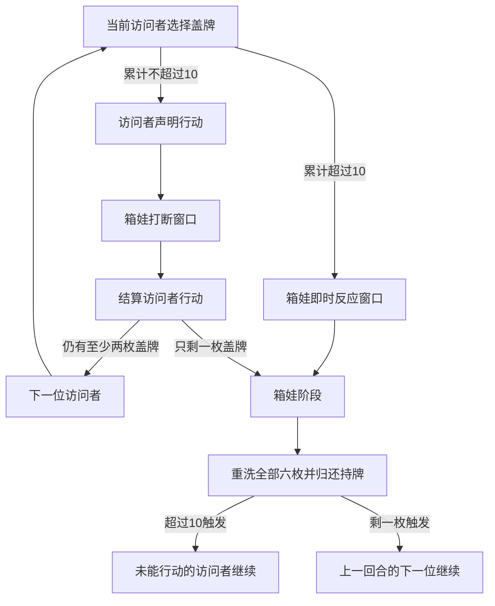

# 无声模式与基础回合引擎

更新：2026-10-26。

本阶段依据[规则笔记](规则与首版范围.md)、[地图资料](地图资料.md)及恢复的说明书，实现四人开局配置与基础回合的网页接入。准备顺序和标志清单见[开局设置](开局设置.md)。

## 模块与边界

| 模块 | 已实现 |
| --- | --- |
| [silent.mjs](../src/silent.mjs) | 六枚0—5标志、翻牌、跳过持牌、累计阈值、箱娃阶段触发、归还洗混及续轮。 |
| [movement.mjs](../src/movement.mjs) | 实际门和楼梯的单步目标、封门筛选、怨房初始潜伏角落、原房或相邻房的潜伏目标。 |
| [round.mjs](../src/round.mjs) | 地图完成后的基础回合组合、移动声明与打断窗口、位置结算、普通潜伏及分玩家视图。 |
| [play.mjs](../src/play.mjs) | 组合完整开局标志与回合：窥探、库存、补位、被动道具、展示交换、三条胜利、死亡和箱人。 |

已实现窥探与补位、随身标志、保险箱、逃脱／讨伐／超度、死亡转箱人及窥探相关携带效果。主动访问者道具、箱娃能力、哭喊抽牌和可用能力栏尚未接入。封门筛选接受能力结算提供的 `blockedDoors`，其生效期限待能力处理器实现。详细规则依据见[探索与胜负](探索与胜负.md)。

2026-10-26已补充[访问者道具](访问者道具.md)、[箱娃之力](箱娃之力.md)与[标志资料](标志资料.md)。超过10后的 `hako_reaction` 是现有组合接口预留的阶段窗口，不代表某张具体能力已获准在此发动；NO.5实际卡面注明箱娃行动阶段使用，NO.12则在无声模式排除。后续能力接入必须依照新核对的卡面时机。

## 初始化与动作

`createRound(setup, {hakoId, hidingCornerId, numbers})` 接收服务器保管的已完成地图状态。箱娃必须明确选择怨房中的一个初始角落。访问者从1楼大厅开始行动；调用者须先完成正门等待、角落标志和其他开局设置。

`numbers` 是测试时指定六枚牌序的可选参数，正式游戏默认洗混；该参数不应开放给浏览器指定。

通过 `applyRoundAction(round, playerId, action)` 执行：

| 动作类型 | 执行者与用途 |
| --- | --- |
| `silent_reveal`，`index` | 当前访问者选择一枚盖牌。 |
| `silent_skip`，`index` | 当前访问者选择一枚盖牌暂持并跳过；0已亮出时拒绝。 |
| `move`，`roomId` | 翻牌成功的访问者声明移动；此时位置尚未改变。 |
| `resolve_visitor_action` | 箱娃结束打断窗口，结算已声明移动；随后结束访问者行动。后续能力处理器在这里之前结算打断。 |
| `pass_noise_reaction` | 箱娃结束累计超过10后的即时反应窗口，进入箱娃阶段。 |
| `hako_hide`，`cornerId` | 箱娃阶段最后的普通移动与潜伏，允许留在原房换角落；随后重置无声标志。调用者须先结算可选哭喊、设置能力和阶段能力。 |

以上动作已作为房间POST动作开放。`inspect_hiding_room`：箱娃阶段先选择当前或相邻房间，查看该房间所有角落，再提交该房间的 `hako_hide`；本阶段不能改看另一房间。箱人用同样的查看动作及 `ghost_hide`，每名箱娃方玩家各完成一次后才重置无声标志。

当前组合层将原角落标志保存在基础标志层，箱娃和箱人位置单独叠加计算。这样能正确保留同一角落的多个箱人和下方标志：潜伏时不重复或覆盖原物；讨伐时按规则一并移除。原始开局副本不作为实时盘面发送。

## 网络准备流程

`start` → 三名访问者依次 `choose_item` → 原 `draw` / `place` 地图流程 → 房主 `prepare_opening` → 箱娃 `choose_secrets`、`place_remains`、`inspect_initial_room`、`choose_initial_hiding`、`choose_initial_power` → 基础回合。

房间快照的 `phase` 依序为 `item_draft`、`map_setup`、`map_ready`、`opening_setup`、`practice`，结局时为 `game_over`。`practice`沿用已有回合接口名，当前 `round.mode` 为 `exploration`。`draft`只在选择道具时提供，`initialItems`公开开局时已选道具；实时持有物品通过本人 `round.inventory` 提供。`opening`仅在开局设置时提供，按玩家过滤。初始能力按说明书公开，通过 `initialPower`提供；秘密牌库仍不发送给访问者。

## 探索动作和事务

- `createPlay(setup, opening, {numbers})` 接受已完成准备，生成包含基础回合、标志、库存和箱人的服务端状态。
- `applyPlayAction(play, playerId, action)` 在复制状态上验证及执行，成功才返回替代状态；任何异常不改变原状态。
- `getPlayView(play, playerId)` 仅列出该玩家有权查看的字段。窥探结果、个人库存、收到的展示、交换邀请和箱人潜伏分别过滤。

新增网络动作：`peek`声明同房窥探，箱娃 `resolve_visitor_action` 后产生私人 `resolution`；本人 `resolve_peek` 取／留及补位，或 `safe_guess` 输入密码。`use_weapon`同样先声明再由箱娃确认。`show_token`只给指定同房玩家查看，`offer_exchange`／`respond_exchange`在双确认且位置物品仍合法时转移。`drop_token`将物品盖放在本房空角。`bequeath`处理戒指继承。`surrender`记录或撤回本人投降票，全体存活访问者同意才结束。

对方尚未主动展示的库存不能通过构造交换请求探测：发起时只验证发起人给出的物品；请求对方的物品在对方接受时才验证。接收人可看清主动给出的物品，旁观者看不到邀请内容。

`round.result`公开结局与获胜玩家；结束后所有动作拒绝。存活访问者显示房间，箱人只公开状态，潜伏位置仅本人获得。死亡公开移除的物品另列为公开弃置记录。

## 阶段与续轮

- 恰好10仍可行动；超过10不结算该访问者行动。
- 跳过是一个结束的回合，同样检查是否只剩一枚盖牌。
- 跳过时持有的标志保持盖放，不向持有者或其他玩家暴露数字；箱娃阶段结束才归还。
- 超过10与只剩一枚同时满足时，以超过10处理，保留即时反应窗口并由未能行动的人续轮。
- 移动按房间计算。同一块板上的两间房须通过内部门，普通移动不能穿过两间房；箱娃普通移动也只允许原房或一步相邻房。

## 信息边界

`getRoundView(round, playerId)` 只允许本局四名玩家调用，并生成与内部状态不共享对象的视图。

- 六枚无声标志只有亮出的数字进入公共视图；暂持标志只公开持有者。
- 访问者位置和声明的移动目标是公共信息。
- 箱娃角落、所在房间及潜伏候选仅出现在箱娃自己的视图中。
- 公共视图不包含私有牌序、待续轮内部字段或整份回合对象；接入 SSE 时必须逐玩家调用此方法。

## 验证

运行 `npm test` 统一覆盖地图、开局、无声规则、移动、探索、三胜利、死亡与箱人及HTTP/SSE服务。四浏览器验收覆盖完整准备、累计10、溢出续轮、秘密窥探、库存刷新、定向展示、确认赠送、结束锁定，以及HTTP/SSE和DOM隐藏信息。

本阶段遵循用户的验证节奏：先完成整块实现，再集中添加测试、统一运行验证和修复，验证通过后提交。
